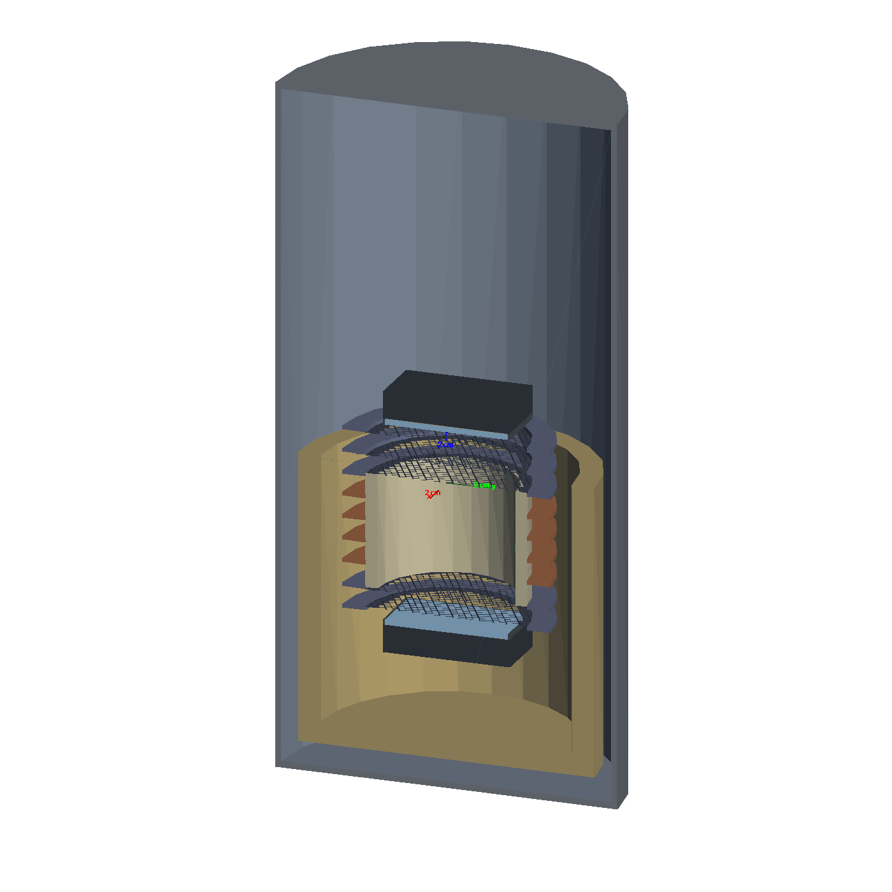

# xams-sim — manual

xams-sim simulates the XAMS dual-phase xenon TPC. It contains one Geant4 program, one Python package and the
electric-field models, all driven from a common configuration (geometry, materials, detector states, sources):

| part | what it does | where |
|---|---|---|
| **`xamsg4`** | Geant4 program with two modes: **optical** (178 nm photons through the TPC → light collection per sensor) and **particle** (radioactive sources / gammas → energy deposits in the xenon) | `g4/` (C++), built to `g4/build/xamsg4` |
| **`xamssim`** | Python package and command: configuration and validation, running both modes, viewers, map registry, readers; later the strax event chain | `xamssim/` |
| **efield** | electric field and electron drift: COMSOL models of the full TPC and of single mesh cells, generated from the configuration | `efield/` |
| **configuration** | the definition: `geometry.yaml`, `materials.yaml`, detector states, sources; example runs and scan | `config/` |
| **checks** | slow checks of Geant4's optical physics against analytic results | `checks/` |

{ width="420" }

## The simulation chain

```
source ──xamsg4 particle──► energy deposits ──► clusters ──► photons + electrons (NEST, local field)
                                                                │                 │
                                          light maps (xamsg4 optical) ◄── S1     drift (field maps, efield)
                                                                │                 │
                                                                │       extraction + electroluminescence ──► S2 photons
                                                                ▼                                              │
                                              photoelectrons per channel ◄──────────── light maps ◄────────────┘
                                                                │
                                              PMT / SiPM response ──► raw_records ──► amstrax (unchanged)
```

Available now: the optical mode (with fitted optics), the particle mode, the field models, configuration and map
registry. The event chain from deposits onwards (strax plugins, partly from XENONnT's fuse) is being built — see the
[roadmap](xams_sim_plan.md). Studies made with xams-sim (run files, analysis, results, PDF notes) are not in this
repository: they live in `../simulations/` (own repository), their outputs in `../simulations/data/`.

## Where to start

1. [Installation](setup.md) — the two conda environments, building `xamsg4`.
2. [Quick start](quickstart.md) — the main commands and what they produce.
3. [Configuration](configuration.md) — how a simulation is described.
4. Running: [particle mode](particle.md), [optical simulation](optical.md), [viewers](viewers.md),
   [electric field](efield.md).
5. [Output formats](output.md) and [reading the output](analysis.md).

## This documentation

Markdown in `docs/`, built with MkDocs:

```bash
conda activate xamssim && cd ~/Documents/XAMS/xams-sim && mkdocs serve   # http://127.0.0.1:8000
```

`mkdocs build` writes the static site to `site/` (not in git). The build is strict: broken links stop it.
