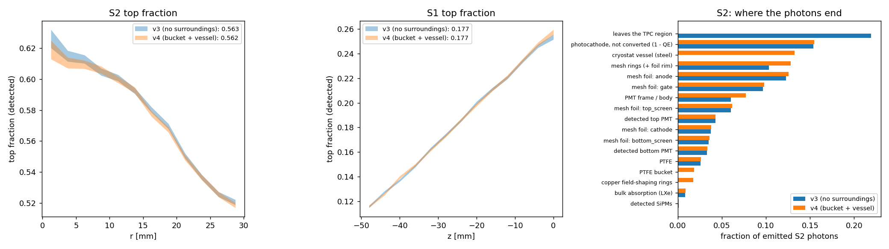

# Surroundings: PTFE around the PMTs, PTFE bucket, cryostat vessel (geometry v4, 2026-10-06)

Geometry v4 adds
- PTFE around both PMTs (drawings `PTFE_between_TS_PMT.pdf`, `PTFE_between_BS_PMT.pdf`): plate between screen ring and
  window (50 mm square opening) + block around the PMT (slot top 56 / bottom 56.9 mm), out to r = 46.3 mm;
- the PTFE bucket (`PTFE_bucket.pdf`: Ø112/132, 129 mm, weir 1.78 mm below the rim sets the liquid level);
- the closed steel vessel (`Inner_cryostat_vessel.pdf`: Ø146.86/152.4, 305 mm), gas around the bucket.
v3 had an absorbing world around the TPC.

One parameter point (level 4 mm, PTFE R 0.95, specular 0.1, steel R 0.35, Rayleigh 45 cm); v3 = that point of the
step-8 fit scans, v4 = `optical/scans/check_v4_s2.yaml` / `check_v4_s1.yaml`; `python optical/surroundings_compare.py`.

| | S2 top fraction | S2 LCE top / bottom | S1 top fraction | S1 LCE top / bottom |
|---|---|---|---|---|
| v3 | 0.5629 ± 0.0006 | 0.0426 / 0.0331 | 0.1767 ± 0.0003 | 0.0135 / 0.0628 |
| v4, bucket + vessel only | 0.5617 ± 0.0006 | 0.0427 / 0.0334 | 0.1770 ± 0.0003 | 0.0135 / 0.0630 |
| v4 (+ PTFE around the PMTs) | 0.5584 ± 0.0006 | 0.0454 / 0.0359 | 0.1791 ± 0.0003 | 0.0147 / 0.0672 |

Bucket and vessel alone: < 1 % (light that leaves the TPC hardly comes back). The PTFE around the PMTs: +7–9 % light
on both PMTs, top fraction −0.005 (S2) / +0.002 (S1), shapes unchanged. ~10 % of the S2 light still ends on the vessel.
Not known (defaults): bucket bottom 10 mm, vessel ends 2.77 mm, vessel bottom 10 mm below the bucket.

